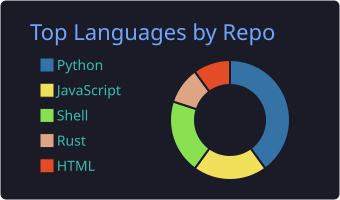
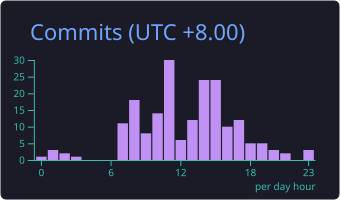

<div align="center">

<picture>
  <source media="(prefers-color-scheme: dark)" srcset="assets/portrait-night.svg" />
  <source media="(prefers-color-scheme: light)" srcset="assets/portrait-dusk.svg" />
  
</picture>

</div>

<br>

## `$ whoami`

```
agents    MCP & Claude Code tooling: the model sees my proxy, debugger, sessions
智能体    MCP 与 Claude Code 工具链：让模型看见我看见的东西

reverse   VMP · signature reproduction · Android unpacking · protocol rebuilds
逆向      VMP 还原 · 签名算法复刻 · Android 加固脱壳 · 协议级复刻

network   NAT traversal and P2P hole punching, with measured numbers
网络      NAT 穿透与 UDP 打洞，数据都是实测

desktop   CachyOS + Hyprland, where the config is the documentation
桌面      CachyOS + Hyprland，配置即文档

method    AI does the legwork; the key step I verify by hand
做法      AI 跑腿，关键那一步我亲手验证
```

<table>
  <tr><td><code>agents</code></td><td> </td></tr>
  <tr><td><code>lang</code></td><td>   </td></tr>
  <tr><td><code>reverse</code></td><td>  </td></tr>
  <tr><td><code>desktop</code></td><td>  </td></tr>
</table>

<sub>Projects are pinned below · 项目见下方置顶 · Upstream: [5 merged PRs](https://github.com/Cnyn0403/claude-discord-sync/pulls?q=is%3Apr+author%3Anumb747) to claude-discord-sync</sub>

<br>

## `$ stat`

<p align="center">&nbsp;</p>

<br>

## `$ finger seven`

[](mailto:cannonewhy123@gmail.com)
[](https://discord.com/users/1079010844505030707)


<sub>Happy to talk AI tooling, reverse engineering, or build something together. Gray-market / paid-content cracking requests — please don't.<br>聊 AI 工具链、聊逆向、一起做点东西都欢迎；灰产、破解付费内容之类的就别来了 🙏</sub>
